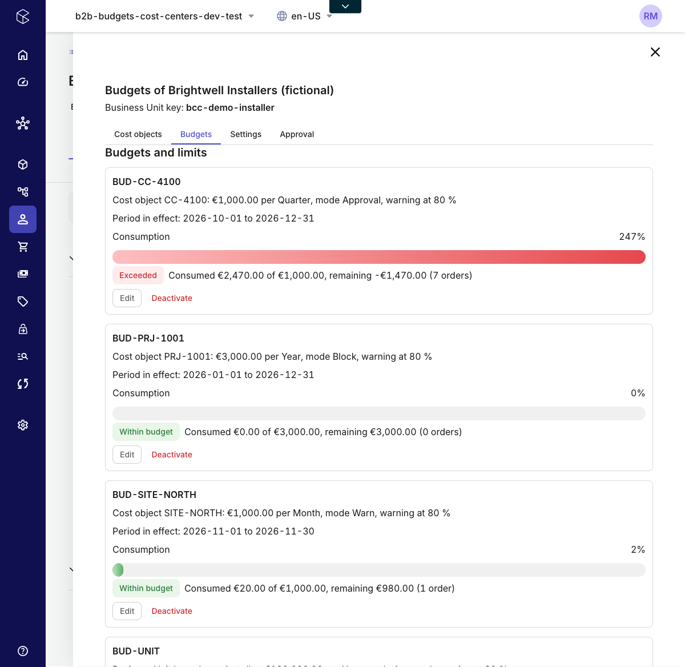

> commercetools-labs reference code, MIT, not supported.
> Freely available under the MIT license, shared as-is. See [SUPPORT.md](SUPPORT.md) and [LICENSE](LICENSE).

# Budgets, Cost Centers & Projects

B2B buyers order against cost centers, projects and sites. Every cart knows its budget status while it is filled;
over-budget orders go through the platform's own Approval Rules. No approval engine, no new order states.

- **Buyers** see on the cart whether it fits the budget (`ok`, `warn`, `exceeded`, `blocked`).
- **Approvers** get native Approval Flows for exactly the orders over budget; a rejected order stops counting.
- **Admins** manage cost objects, budgets, role limits and the Approval Rule in one Merchant Center panel, and export
  spend as CSV.



Budgets apply per cost object or Business Unit and period, limits per Associate Role or associate. Each budget has a
mode: `approval`, `warn` or `block`; the strictest applicable outcome wins.

## How it works

| App | Connect type | Job |
| --- | --- | --- |
| [`service`](service/README.md) | `service` (API Extension) | Budget snapshot on every B2B cart change, order guard, cost object on quotes |
| [`ledger`](ledger/README.md) | `event` (Subscription) | Approval outcome onto the order (`pending`, `approved`, `rejected`) |
| [`budget-view`](budget-view/README.md) | `merchant-center-custom-view` | Panel on the Business Unit page |

Data lives in Custom Objects (`bcc-cost-objects`, `bcc-budgets`, `bcc-settings`) and in `bcc*` Custom Fields on carts
and orders. Every app has its own least-privilege API Client. Measured on a Connect preview: p95 137 ms per cart update.

## Install

1. Turn on Messages querying (Settings > Developer settings); the `ledger` verifies every Message through it.
2. Register the Custom View (profile > Manage organizations & teams > Custom Views > Configure). Verify the contact
   email first. Use a placeholder URL, the scopes from [budget-view](budget-view/README.md), entry point Business Unit
   general page, extended panel. Note the Custom View ID.
3. Create the two API Clients with the scopes in [service](service/README.md) and [ledger](ledger/README.md).
4. Create a Connector from a Git tag of this repository (private repositories: give `connect-mu` read access) and
   deploy it with each app's configuration, including `CUSTOM_VIEW_ID` and the `CLOUD_IDENTIFIER` of your region
   (default `gcp-eu`).
5. Set the Custom View URL to the `budget-view` URL of the Deployment, set the view to Ready and install it.
6. In the panel: set up the Approval Rule, then cost objects and budgets.

Existing Custom Types for carts, orders, quotes or shopping lists: set the type keys to them; the package only adds
its `bcc` fields.

## Limits

- Consumption is computed live from orders; large order volumes make the cart check slower.
- Two carts checked against the same remaining budget can both be ordered.
- Returns and refunds are out of scope; a cancelled order stops counting, a returned one still counts.
- Orders from quotes carry the cost object and count, but budget approval on them is not guaranteed.
- Recurring orders are checked once, when the recurring cart is created. Imported orders (Order Import) are not
  checked, because the platform calls no Extension for them.
- Approval Rules apply only to requester roles; an uncovered buyer over budget is blocked.
- The panel manages Approval Rules on behalf of an associate of the unit and says whose.
- Budgets apply per currency; periods are computed in UTC.
- Undeploy removes the Extension and the Subscription and keeps types and data. The Custom View registration stays
  in your organization.
- The cart check keeps units, settings, cost objects and budgets for 60 seconds (`BCC_CACHE_SECONDS`, 0 turns it off),
  so a change in the panel reaches carts after at most that delay. Orders are read live; the order guard never uses the
  cache.
- Sandbox and preview Deployments sleep when idle; the first cart call after a pause can time out.

## Develop

Node 22 or later.

```bash
for d in core shared service ledger seed budget-view; do (cd $d && npm ci); done
npm test                 # all suites, trace, package and Connect build checks
npm run e2e:latency      # 200 cart updates against a sandbox with the seed
```

Requirements live in [openspec/specs](openspec/specs) with IDs like `[BCC-CART-5]`; code and tests cite them
([traceability](docs/traceability.md)). Design: [docs/design.md](docs/design.md). Features:
[FEATURES.md](FEATURES.md). Local runs and the seed: `node tools/run-local.mjs <service|ledger|seed>` with the
secrets file described in [docs/backlog.md](docs/backlog.md).

See [SUPPORT.md](SUPPORT.md) and [LICENSE](LICENSE).
